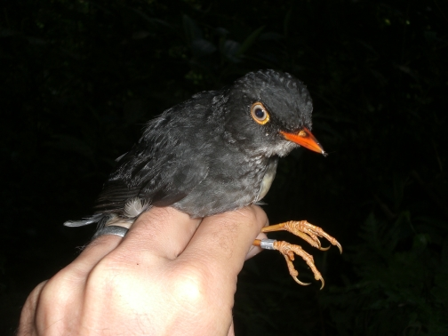
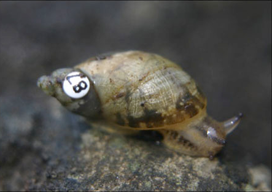
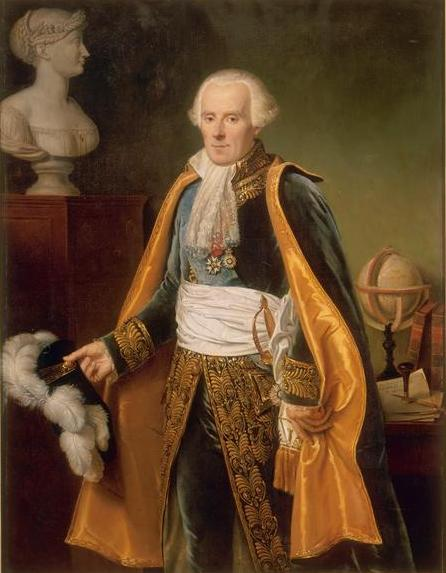
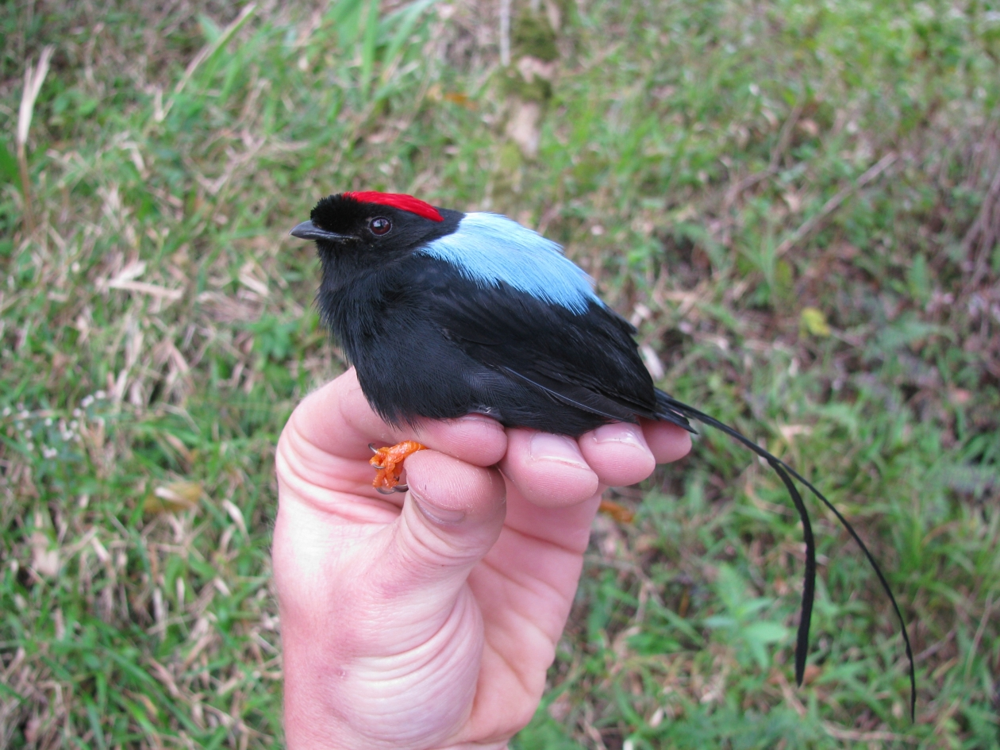
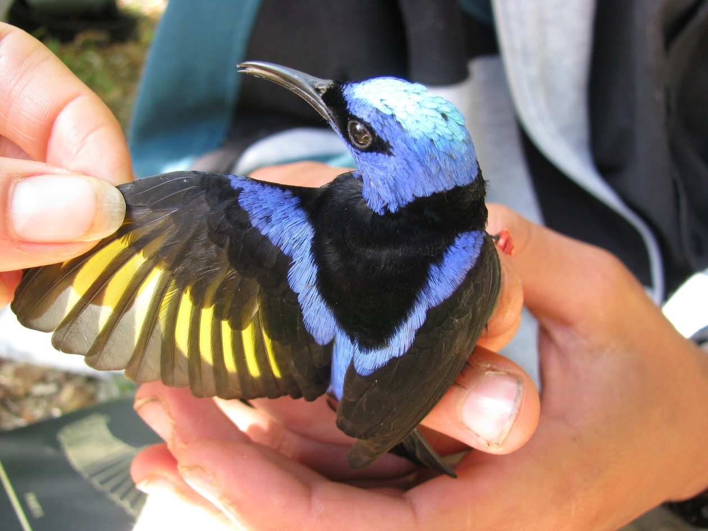
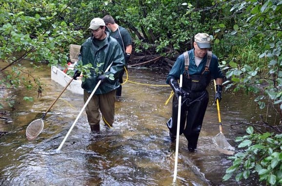
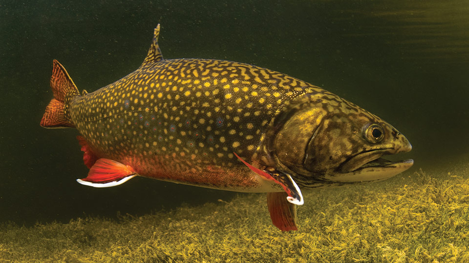
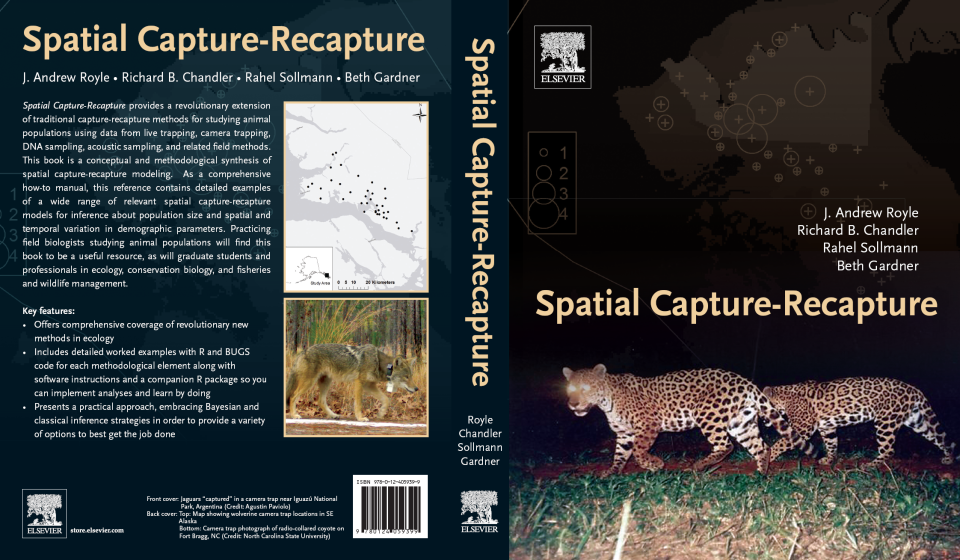

# Introduction {visibility="hidden"}

## {content-align="center" style="font-size: 160%;"}


<center>

**Capture-mark-recapture methods for abundance estimation**
    
{height="8cm"}
{height="8cm"}

</center>


## Abundance estimation
  
Same old equation:

$$
    \hat{N} = \frac{n}{\hat{p}}
$$
  
- $N$ is abundance (population size)
- $n$ is the number of individuals detected
- $\hat{p}$ is an estimate of detection probability: The probability of detecting an individual
  

::: {.fragment}
<center>
**Most methods differ in how they estimate $p$**
</center>
:::


## Overview

<br>

::: {style='font-size: 80%;'}
Estimating $p$
    
::: {.incremental}
- Set traps in a study area and mark each captured individual
- Repeat the trapping on $K$ occasions
- On each occasion, mark new individuals and record recaptures
- If capture probability is high...
    * You will detect most of the population on the first occasion
    * Most of the captures on subsequent occasions will be recaptures
- And vice versa
:::

:::

  


## Encounter histories

<br>

::: {style='font-size: 80%;'}
$n=5$ individuals captured over 3 sampling occasions
  
<center>
    
Individual | Occasion 1 | Occasion 2 | Occasion 3
---------- | ----------- | ------------ | -----------
1 | 0 | 0 | 1
2 | 1 | 1 | 0
3 | 1 | 1 | 1
4 | 1 | 0 | 0
5 | 0 | 1 | 0

</center>

These data tell us about $p$ and hence $N$. Estimation is usually acheived using maximum likelihood methods.
:::


# Lincoln-Peterson


## Lincoln-Peterson Method


::: {style='font-size: 80%;'}
The original method was first used by Pierre-Simon LaPlace to estimate the human population in France.   <br>

<center>
{height="9cm"}
{height="9cm"}
</center>

Later it was used by Lincoln (shown above) and Peterson to estimate fish and wildlife populations.
:::


 
## Lincoln-Peterson Study Design

::: {style='font-size: 80%;'}

- There are only 2 capture occasions
- On the first, $n_1$ animals are captured and marked
- On the second, $n_2$ animals are captured and $m_2$ of them are recaptures

<center>
{height="8cm"}
{height="8cm"}
</center>

:::
 


## Lincoln-Peterson Abundance Estimator

<br>

::: {style='font-size: 80%;'}
How can we use $n_1$, $n_2$, and $m_2$ to estimate $N$?

::: {.fragment}
$$
    \frac{n_1}{N} = \frac{m_2}{n_2}
$$
:::

  

::: {.fragment}
And so...

$$
    \hat{N} = \frac{n_1n_2}{m_2}
$$
:::
:::


## Lincoln-Peterson Assumptions

::: {style='font-size: 80%;'}
<br>

- Population closure
    * No births
    * No deaths
    * No immigration or emigration

::: {.fragment}
- All individuals are assumed to have the same capture probability
:::

::: {.fragment}
- No tag loss or mis-identification
:::
:::
  


# $K$-sample CMR


## *K*-sample CMR

::: {style='font-size: 90%;'}
Using more than 2 sampling occasions has many advantages, including the ability to account for:

- Temporal variation
- Behavioral effects
    * Trap happiness
    * Trap shyness
- Individual heterogeneity
- Combinations of the above
:::
  


## Common models


::: {style='font-size: 80%;'}


Model | Description
----- | ----------------------
$M_0$ | The most basic model in which $p$ and $c$ are constant
$M_t$ | $p$ differs among sampling occasions and $p_t=c_t$.
$M_b$ | Behavioral response model in which $p$ and $c$ differ. Can describe trap happiness or trap shiness.
$M_{tb}$ | A combination of models $M_t$ and $M_b$.

<br>

where


$p =$ capture probability <br>
$p_t =$ capture probability on occasion $t$ <br>
$c =$ recapture probability


:::


# Removal sampling


## Removal sampling

<br>


{height="8cm"}
{height="8cm"}

<center>
[Video](https://youtu.be/W3lcHdFyzrQ)
</center>


## Removal sampling
  
::: {style='font-size: 80%;'}


Suppose you conduct several electrofishing passes on a single stream section, and you remove individuals on each pass.
  
::: {.fragment fragment-index=1}
Eventually you should deplete the population.
:::
  
::: {.fragment fragment-index=2}
The number of captures you would expect on each pass:
:::

:::

::: {.fragment fragment-index=2}
::: {style='font-size: 65%;'}
<center>

Pass | Expected captures
---- | -----------------
1 | $pN$
2 | $p(1-p)N$
3 | $p(1-p)^2N$
4 | $p(1-p)^3N$
$\vdots$ | $\vdots$
K | $p(1-p)^{K-1}N$

</center>
:::
:::


## Example

  
::: {style='font-size: 80%;'}
The rate at which the population is depleted tells us about $p$, and therefore how many individuals we missed.
:::

```{r}
#| label: rem
#| include: true
#| echo: false
#| fig-width: 7
#| fig-height: 4.1
#| fig-align: 'center'
#| out-width: '99%'
N <- 100
p1 <- 0.8
p2 <- 0.3
pi1 <- c(p1, p1*(1-p1), p1*(1-p1)^2)
pi2 <- c(p2, p2*(1-p2), p2*(1-p2)^2)
pi1[4] <- 1 - sum(pi1)
pi2[4] <- 1 - sum(pi2)
set.seed(0324)
x1 <- drop(rmultinom(1, N, pi1))
x2 <- drop(rmultinom(1, N, pi2))
par(mfrow=c(1, 2), mai=c(0.8,0.9,0.8,0.2))
barplot(x1[1:3], main="p=0.8, N=100", cex.lab=1.2, cex.main=1.2, cex.axis=1.1, xlab="Pass", names=1:3, ylab="Captures")
barplot(x2[1:3], main="p=0.3, N=100", cex.lab=1.2, cex.main=1.2, cex.axis=1.1, xlab="Pass", names=1:3, ylab="Captures")#; box()
```


## Estimating density
  
::: {style='font-size: 80%;'}
Lingering questions
  
- How do we convert abundance to density?
- What is the area surveyed?
- How do we model spatio-temporal variation in density?
:::

<center>
{height="8cm"}
</center>


## Summary

<br>

Capture-recapture methods use information about recapture rates to estimate capture probability and abundance.

<br>

::: {.fragment}
Modern methods use camera traps or DNA sampling techniques to collect non-invasive capture-recapture data and estimate density and vital rates.
:::


## Assignment

<br><br><br><br>

<center>
::: {style='font-size: 140%;'}
Read Chapter 11
:::
</center>


