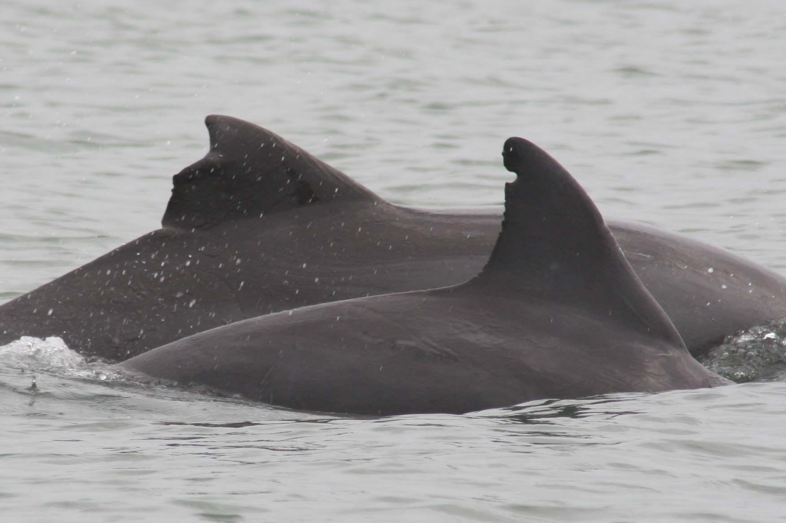
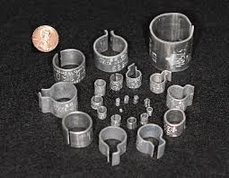
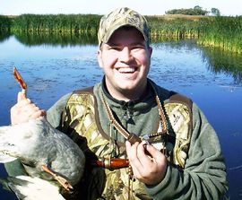
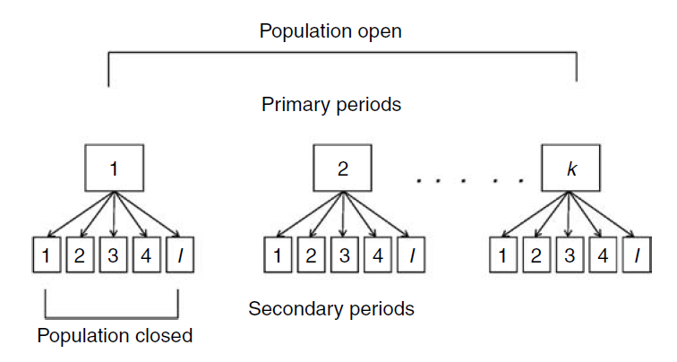

# Introduction {visibility="hidden"}

## {content-align="center" style="font-size: 160%;"}

**Mark-recapture methods for estimating survival and recruitment**

{height="8cm"}
{height="8cm"}

## Accounting for imperfect detection

::: {style='font-size: 80%;'}
Suppose we mark and release $R$ individuals, and then recapture $m$ of them on the second occasion. How do we estimate survival probability?
    
::: {.fragment}
If capture probability ($p$) was 1, we could use:
$$
  \hat{S} = \frac{m}{R}
$$
:::
    

::: {.fragment}
But when $p<1$, $m$ is some fraction of the number actually alive ($M$), so we have to estimate $p$ and $M$ to estimate $S$:
:::
    
::: {.fragment}
::: {.columns}
::: {.column width="30%"}
$$
  \hat{S} = \frac{\hat{M}}{R}
$$
:::
::: {.column width="30%"}

 
where

:::
::: {.column width="30%"}
$$
  \hat{M} = \frac{m}{\hat{p}}
$$
:::
:::
:::
:::

# Tag recovery models

## Tag recovery models

::: {style='font-size: 80%;'}
**Purpose**

Estimate survival from recovered tags  
  

  
::: {.fragment}
**Benefit**

Because hunters are just about everywhere, we don't have to worry about animals leaving "the study area" and we can estimate actual survival.
:::

:::

## Tag recovery models

::: {style='font-size: 70%;'}
**Design**
   
* Animals are marked and released
* Hunters or anglers report tags from harvested individuals
* Desirable to have at least 5 releases
  
  
::: {.fragment}
**Data**

Three release years followed by 3 years of recoveries:

::: {style='font-size: 80%;'}
+-----------------+-----------------------------------+
| Number released | Period recovered                  |
+:===============:+:=========:+:=========:+:=========:+
|                 | 1         | 2         | 3         |
+-----------------+-----------+-----------+-----------+
| $R_1$           | $m_{1,1}$ | $m_{1,2}$ | $m_{1,3}$ |
+-----------------+-----------+-----------+-----------+
| $R_2$           |           | $m_{2,2}$ | $m_{2,3}$ |
+-----------------+-----------+-----------+-----------+
| $R_3$           |           |           | $m_{3,3}$ |
+-----------------+-----------+-----------+-----------+
:::

:::
  

:::

## Tag recovery models

::: {style='font-size: 70%;'}
**Expected values**

+--------------+--------------+-----------------------------------------+
| Period       | Number       | Period recovered                        |
| released     | released     |                                         |
+:=============+:============:+:========:+:===========:+:==============:+
|              |              | 1        | 2           | 3              |
+--------------+--------------+----------+-------------+----------------+
| 1            | $R_1$        | $R_1f_1$ | $R_1S_1f_2$ | $R_1S_1S_2f_3$ |
+--------------+--------------+----------+-------------+----------------+
| 2            | $R_2$        |          | $R_2f_2$    | $R_2S_2f_3$    |
+--------------+--------------+----------+-------------+----------------+
| 3            | $R_3$        |          |             | $R_3f_3$       |
+--------------+--------------+----------+-------------+----------------+

  
  
**Parameters**
   
* Survival ($S$)
* Recovery rate ($f$)
  
::: {.fragment}

Software programs like "MARK" (and "RMark" and "Rcapture" in R) find the most likely values of $S$ and $f$, given the data.

:::

:::

## Tag recovery models
  
::: {style='font-size: 80%;'}
::: {.columns}

::: {.column width="60%"}
**Assumptions**
  
* Sample is representative of population
* No tag loss, mis-identification, etc\dots
* All animals have common survival and recovery rates
* Fates are independent
::: 
  
::: {.column width="40%"}

::: {.fragment}
**Extensions**
  
* Age-specific models
* Grouping variables
* Time variables
* Habitat variables
:::
:::
    
:::

 

::: {.fragment}

[Canada goose banding video](https://youtu.be/baQAjq0NyrM)

[Duck banding video](https://youtu.be/J8lfqZ46OQ0)

:::

:::

# CJS model

## Cormack-Jolly-Seber (CJS) model

::: {style='font-size: 80%;'}
**Purpose**

Estimate survival and capture probability from capture-recapture data
  
  
::: {.fragment}
**Design**

A random sample of animals is marked and followed over many periods (usually years)
:::
  
::: {.fragment}
**Notes**

* When permanent emigration is possible, we can't be sure if an animal died or left study area
* So, we often have to estimate "apparent survival" ($\Phi$) instead of actual survival ($S$)
* Apparent survival is the probability that an individual survives and does not permanently emigrate out of the study area
:::

:::

## CJS capture histories

::: {style='font-size: 90%;'}

In CJS studies, we ignore the leading zeros in the capture histories because we aren't interested in how animals enter the sample.
  
All we care about is survival, so we "condition" on first encounter.
  
             Year 1   Year 2   Year 3
  ---------- -------- -------- --------
  Animal 1      1        0        0
  Animal 2               1        0
  Animal 3                        1
  Animal 4      1        1        1
  Animal 5               1        1
    

:::

## CJS capture histories
  
::: {style='font-size: 90%;'}
Estimation is accomplished by finding the values of $p$ and $\Phi$ that best align the expected values with the observed capture histories.
  

  Capture history   Expected values
  ----------------- -----------------------------------------
  111               $\Phi_1p_2\Phi_2p_3$
  110               $\Phi_1p_2(1-\Phi_2p_3)$
  101               $\Phi_1(1-p_2)\Phi_2p_3$
  100               $(1-\Phi_1)+\Phi_1(1-p_2)(1-\Phi_2p_3)$

:::

## CJS model

::: {style='font-size: 80%;'}
**Assumptions**
  
- Same as tag-recovery, plus\dots
- Instantaneous recapture and release of animals
- Homogeneity of capture and survival probabilities for marked animals
- All emigration is permanent
  
::: {.fragment}
**Model can be extended to accommodate variation due to...**
  
- Age
- Sex
- Habitat
- Geographical regions
:::
:::
  

# JS model

## Jolly-Seber (JS) model

::: {style='font-size: 90%;'}
**Purpose**

Estimate survival, recruitment, abundance, and capture probability from capture-recapture data
  
  
::: {.fragment}
**Design**

Randomly sample the population during every period and mark all newly captured unmarked animals
:::
  
  
::: {.fragment}
**Examples**
  
- Constant-effort mist-netting
- Long-term small mammal trapping
:::
:::
  

## Recruitment in the Jolly-Seber model

::: {style='font-size: 90%;'}
 

Recruitment in JS models is defined as the per-capita rate at which new individual enter the population.

 

::: {.fragment}
If immigration is not possible, recruitment is equivalent to fecundity.
:::
  
 

::: {.fragment}
Note that in other applications, recruitment is defined as the product of the birth rate and the probability of surviving to maturity.
:::
:::

## JS capture histories

::: {style='font-size: 85%;'}
We no longer "condition" on first encounter -- Instead, we use all the data.
  
The leading zeros provide information about when individuals are recruited into the population.

              Year 1   Year 2   Year 3
  ---------- -------- -------- --------
  Animal 1      1        0        0
  Animal 2      0        1        0
  Animal 3      0        1        1
  Animal 4      1        1        1
  Animal 5      0        1        1
    
:::

## Jolly-Seber model

**Assumptions**
  
- All the assumptions of CJS model, plus...
- Every animal --- marked or unmarked --- has the same probability of capture
  
The standard JS model doesn't work very well, but it is extremely powerful when combined with *the robust design*.

# Robust design

## Robust design

::: {style='font-size: 80%;'}
**Purpose**

Relax assumptions and increase precision by collecting more data.

 
  
::: {.fragment}
**Key concept**

We now have two types of sampling periods:

- *Primary sampling periods* between which the population is assumed to be demographically open
- *Secondary sampling periods* over which the population  is assumed closed
:::
  
 

::: {.fragment}

The replicate surveys with each primary period give us direct information about capture probability, which makes it easier to estimate the other parameters.

:::

:::

## Robust design capture histories

{height="5cm"}

::: {style='font-size: 60%;'}
Example with 2 primary periods and 3 secondary periods:
  
+----------+--------------------------+---+--------------------------+
|          | Primary period 1         |   | Primary period 2         |
+:=========+:======:+:======:+:======:+:=:+:======:+:======:+:======:+
| 2-4      | Day 1  | Day 2  | Day 3  |   | Day 1  | Day 2  | Day 3  |
+----------+--------+--------+--------+---+--------+--------+--------+
| Animal 1 | 0      | 0      | 1      |   | 1      | 0      | 0      |
+----------+--------+--------+--------+---+--------+--------+--------+
| Animal 2 | 1      | 0      | 1      |   | 1      | 1      | 1      |
+----------+--------+--------+--------+---+--------+--------+--------+
| Animal 3 | 0      | 0      | 0      |   | 1      | 0      | 0      |
+----------+--------+--------+--------+---+--------+--------+--------+
| Animal 4 | 1      | 1      | 1      |   | 0      | 0      | 0      |
+----------+--------+--------+--------+---+--------+--------+--------+
| Animal 5 | 0      | 0      | 0      |   | 1      | 1      | 0      |
+----------+--------+--------+--------+---+--------+--------+--------+

:::

## Summary

::: {style='font-size: 80%;'}
  Method         Data         Survival   Recruitment   Abundance
  -------------- ------------ ---------- ------------- -----------
  Tag recovery   Recoveries   Yes        No            No
  CJS            Mark-recap   Yes$^1$    No            No
  JS             Mark-recap   Yes$^1$    Yes           Yes
  
Each of these three methods is widely used in practice. The best option depends on the objectives.
:::

   

::: {style='font-size: 50%; color: gray;'}
$^1$ Apparent survival
:::

