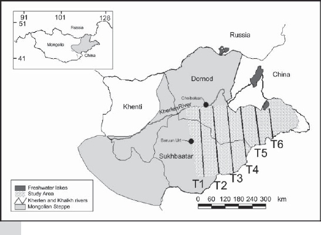

# Introduction {visibility="hidden"}

## {content-align="center" style="font-size: 160%;"}

**Distance sampling**

    
{height="13cm"}
{height="13cm"}

## Estimating abundance
  
::: {style='font-size: 90%;'}
Abundance estimation is often accomplished using this equation:
$$
    \hat{N} = \frac{n}{\hat{p}}
$$
  
- $N$ is abundance (population size)
- $n$ is the number of individuals detected
- $\hat{p}$ is an estimate of detection probability: The probability of detecting an *individual*
:::

::: {.fragment}

**Most methods differ in how they estimate $p$**

:::

## Estimating abundance
  
Challenges:
  
::: {.incremental}

- Detection probability is rarely constant
- It is a function of:
    * Age
    * Sex
    * Habitat
    * **Distance**
    
:::

## Distance Sampling

  
::: {style='font-size: 75%;'}
Basic idea:
  
- $p_i$ is the probability of detecting individual $i$ at distance $x_i$.

::: {.fragment}
- Since every individual in the population has a different detection probability, we replace $p$ with the *average* detection probability ($\bar{p}$)
:::

::: {.fragment}
- The equation is now:

$$
      \hat{N} = \frac{n}{\hat{\bar{p}}}
$$
:::
  
::: {.fragment}
Advantages of distance sampling:
    
- Population size can be estimated from a single survey
- Explicit link between population size and density
:::
    
:::

## Design
  
- Randomly place line transects or points throughout the study area
- Record the distance to each animal detected
  
::: {.columns}
::: {.column width='50%'}
Line transects

:::
::: {.column width='50%'}
Point transects

:::
:::

# Line transects

## Line transects
  

In line transect sampling, it is common to record the radial distance and bearing, rather than the perpendicular distance. However, the analysis must be conducted on the perpendicular distance data.

## Real design
  

 
Mongolian gazelle (*Procapra gutturosa*)

 
  
::: {.columns}
::: {.column width='55%'}

:::
::: {.column width='45%'}
_Gazella_gutturosa)
:::
:::

## Line transects

::: {.columns}
::: {.column width='50%'}
      

Animal		| Distance	($x$)
------		| -------------
1			| 4.4		
2			| 25.3		
3			| 41.8		
4			| 3.1		
5			| 78.5		
$\vdots$	| $\vdots$
$n$			| 4.4		

:::
::: {.column width='50%'}

:::
:::

## [Estimating average detection probability]{style="font-size: 80%;"}
    
::: {style='font-size: 80%;'}
- Fit a detection function, $\mathrm{g}(x)$, to the data
    * Assume $\mathrm{g}(0) = 1$

::: {.fragment}
- Assume individuals are "uniformly" distributed with respect to the transect (valid under random sampling): $p(x) = 1/B$ where $B$ is the transect half-width.
:::

::: {.fragment}
- $\bar{p}$ is then the average detection function, weighted by $p(x)$. 

$$\bar{p} = \int_0^B g(x)p(x) \mathrm{d} x$$.
:::
    
::: {.fragment}

:::
:::

## [Computing average detection probability]{style="font-size: 80%;"}

::: {.r-stack}

::: {.fragment .fade-out fragment-index=1}
{height="13cm"}
:::

::: {.fragment .fade-in-then-out fragment-index=1}
{height="13cm"}
:::

::: {.fragment .fade-in-then-out fragment-index=2}
{height="13cm"}
:::

::: {.fragment .fade-in-then-out fragment-index=3}
{height="13cm"}
:::

::: {.fragment .fade-in-then-out fragment-index=4}
{height="13cm"}
:::

::: {.fragment .fade-in-then-out fragment-index=5}
{height="13cm"}
:::

::: {.fragment .fade-in-then-out fragment-index=6}
{height="13cm"}
:::

::: {.fragment .fade-in-then-out fragment-index=7}
{height="13cm"}
:::

:::

## 

::: {.r-fit-text}

[Shiny App](https://richard-chandler.shinyapps.io/distance-sampling/)

:::

## Assumptions
  
::: {style='font-size: 90%;'}
::: {.incremental}

1. Animals on the line are detected with certainty (i.e., $p=1$ when distance=0).
2. Animals do not move during the survey
3. Distance is measured accurately
4. Transect lines are placed randomly with respect to the animals
    * This ensures that individuals will be uniformly distributed with respect to the transect
5. Detections (of individuals or groups) are independent of one another
  
:::
:::

# Point transects

## Point transects

## [Differences between point vs line transects]{style="font-size: 80%;"}
  
We still use the same type of detection function (half-normal, hazard, etc...).
  
::: {.fragment}
We don't expect a "flat" histogram of distances when $\bar{p}=1$. Why?
:::
  
::: {.fragment}
More individuals occur far from the observer than close to the observer because area increases with distance.
:::

## Point Transects
  
When average detection probability is 1, the histogram of distances will look like this because there is more area (and hence more individuals) far from the point.

## Point Transects

If average detection probability is less than 1, the histogram will increase and then decline. 

## Point Transects

The fitted curve will look like this

## Assignment
  

    Read Chapter 10 -- Capture-Mark-Recapture

