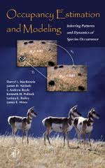
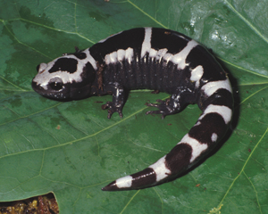
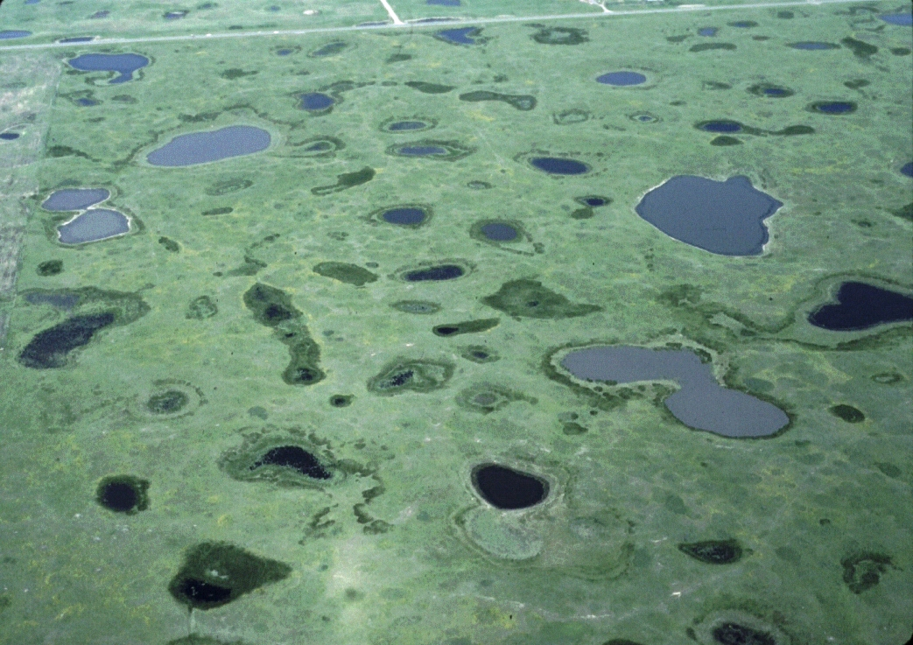
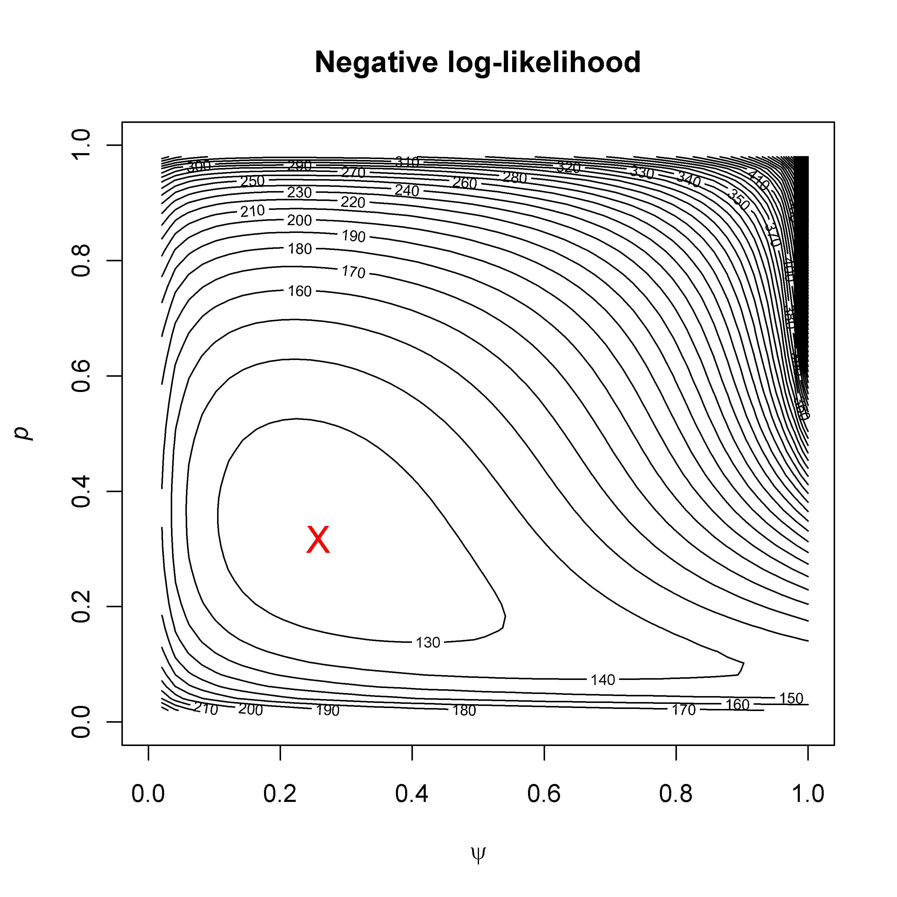
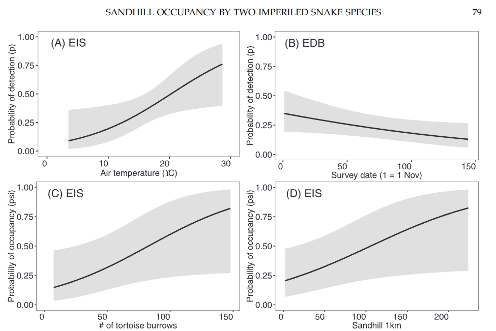
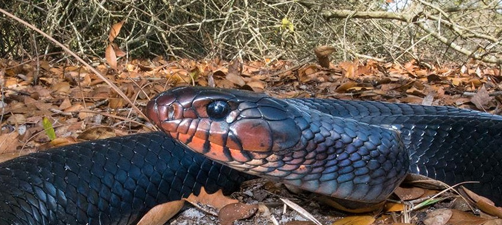
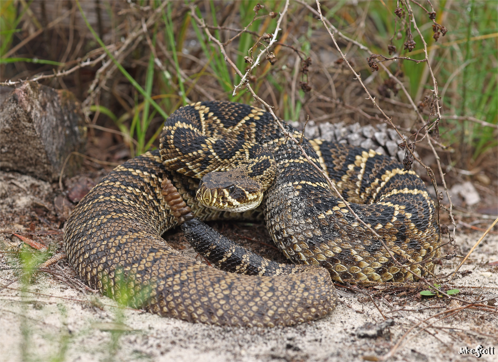

# Introduction {visibility="hidden"}

## {content-align="center" style="font-size: 160%;"}


<center>

**Occupancy Estimation and Modeling**

<br>
    
{height="11cm"}
{height="11cm"}


</center>


## Motivation

::: {style='font-size: 80%;'}
Occupancy models were developed to estimate metapopulation parameters when **detection probability** ($p$) is $<1$.

$$
    \psi_{i,t+1} = O_{i,t}(1-\varepsilon) + (1-O_{i,t})\gamma \\
    O_{i,t+1} \sim \mbox{Bernoulli}(\psi_{i,t+1})
$$
  
  
::: {.fragment}
Metapopulation parameters:

- $\psi$ -- Probability that a site is occupied
- $\gamma$ -- Probability that an unoccupied site becomes colonized
- $\varepsilon$ -- Probability that an occupied site goes extinct
- $p$ -- Probability of detecting at least one individual at a site that is occupied (on a single sampling occasion)
:::

:::
  


## Detection probability

<br>

::: {style='font-size: 95%;'}
If $p<1$, we might incorrectly conclude that a site is unoccupied if we don't detect any individuals

<br>

::: {.fragment}
Consequences:

1. We will underestimate the state variable: The proportion of sites occupied
2. We might make incorrect conclusions about habitat relationships
:::
:::
  


# Single-season models {visibility="hidden"}


## Single-season models

<br>

::: {style='font-size: 90%;'}
Scenario
  
::: {.incremental}

- No interest in colonization or extinction events
- Instead, we directly estimate $\psi$ during one season
- Useful for assessing snapshot of habitat relationships or for modeling a species' distribution
- We assume **population closure**: A site's occupancy state does not change during the survey period (season)
- Definitions of site and season are very important
  
:::

:::


##  {background-image="figs/Prairie_Pothole_Wetlands.jpg"}

<br><br><br><br>

<center>
::: {style="font-size: 130%; color: white;"}
**How many potholes are occupied by mallards?**
:::
</center>

<!-- <center> -->
<!-- {height="12cm"} -->
<!-- </center> -->


## Single-season model

<br>

::: {style='font-size: 90%;'}
Model for the occurrence state
$$
  O_{i} \sim \mbox{Bernoulli}(\psi)
$$


::: {.fragment}
Model for the data
$$
  y_{ij} \sim \mbox{Bernoulli}(O_i \times p)
$$
:::
:::

<br>

::: {.fragment}
<center>
We need to estimate $\psi$ (occurrence probability) and $p$ (detection probability)
</center>
:::


## Design
  
To estimate $\psi$ and $p$, we should use a good study design:

- We need multiple sites
- Sites should be randomly selected
- We must have multiple sampling occasions at (a subset of) the sites


## Data *y~ij~* -- low detection probability

<!-- 10 sites and 3 sampling occasions -->
  
::: {style='font-size: 70%;'}
<center>

             Occasion 1   Occasion 2   Occasion 3
  --------- ------------ ------------ ------------
  Site 1         0            0            1
  Site 2         0            0            0
  Site 3         0            0            0
  Site 4         1            0            0
  Site 5         0            0            0
  Site 6         1            0            1
  Site 7         1            0            0
  Site 8         0            0            0
  Site 9         0            1            0
  Site 10        0            0            0

</center>
:::


## Data *y~ij~* -- high detection probability

<!-- 10 sites and 3 sampling occasions -->
  
::: {style='font-size: 70%;'}
             Occasion 1   Occasion 2   Occasion 3
  --------- ------------ ------------ ------------
  Site 1         1            1            1
  Site 2         0            0            0
  Site 3         0            0            0
  Site 4         1            1            1
  Site 5         0            0            0
  Site 6         1            0            1
  Site 7         1            1            1
  Site 8         0            0            0
  Site 9         0            1            1
  Site 10        0            0            0
:::


## How do we estimate $\psi$ and $p$?
  
::: {style='font-size: 85%;'}
::: {.columns}
::: {.column width='60%'}

Maximum likelihood
      
- This method tries to find the most "likely" values of $\psi$ and $p$, given the data
- It can also be used to estimate standard errors (SEs) and confidence intervals (CIs)

::: {.fragment}
<center>
::: {style='font-size: 130%;'}
[**Shiny app**](https://rbchan-occupancy.share.connect.posit.cloud/)
:::
</center>
:::

:::
::: {.column width='40%'}

:::
:::

::: {.fragment}
Software: Program `PRESENCE`, Program `MARK`, `R` package `unmarked`
:::
  
:::


## Estimates

::: {style='font-size: 55%;'}
             Occasion 1   Occasion 2   Occasion 3
  --------- ------------ ------------ ------------
  Site 1         0            0            1
  Site 2         0            0            0
  Site 3         0            0            0
  Site 4         1            1            0
  Site 5         0            0            0
  Site 6         1            1            1
  Site 7         1            0            0
  Site 8         0            0            0
  Site 9         0            1            0
  Site 10        0            0            0

:::

::: {style='font-size: 80%;'}
Naive occupancy = 5/10 = 0.50 <br>
Estimated occupancy = $\hat{\psi} = 0.61 \pm 0.22$ <br>
Estimated detection = $\hat{p} = 0.44 \pm 0.16$ <br>
:::


## Overall detection probability

<br>

If you sample a site $K$ times, how do you calculate overall detection probability ($\bar{p}$)?

::: {.fragment}
$$
  \bar{p} = 1 - (1-p)^K
$$
  
  
$\bar{p}$ is detection probability after $K$ sampling occasions <br>
$p$ is detection probability on a single occasion <br>
$K$ is the number of sampling occasions (e.g., visits to a site)
:::


## Assumptions
  
::: {.incremental}

- Population closure: Occurrence state does not change during sampling
- Occurrence probability is the same for all sites, unless we account for *covariates*
- Detection probability is the same for all sites and sampling occasions, unless we account for covariates
- Statistical independence
  
:::


## Covariates
  
The value of $\psi$ or $p$ may depend on other variables, e.g. habitat, weather, observer abilities. 

<br>
  
::: {.fragment}
Covariate effects can be accounted for by treating detection probability as a function. 
:::

<br>

::: {.fragment}
A common choice is the logit-linear model:
$$
  \mbox{logit}(\psi_i) = \beta_0 + \beta_1\mbox{ELEV}_i
$$
:::


## Covariates

```{r}
#| label: cov1
#| echo: false
#| fig-height: 7
#| fig-width: 15
#| out-width: '100%'
#| fig-align: 'center'
par(mfrow=c(1,2), mai=c(0.9,0.9,0.2,0.2))
plot(function(x,beta0=-2,beta1=0.01) plogis(beta0 + beta1*x), 0, 1000,
     xlab="Elevation (m)", ylab="Occurrence probability", ylim=c(0,1),
     cex.lab=1.7, lwd=2)
plot(function(x,beta0=4,beta1=-0.1) plogis(beta0 + beta1*x), 30, 90,
     xlab="Temperature", ylab="Detection probability", ylim=c(0,1),
     cex.lab=1.7, lwd=2)
```


<center>
::: {style='font-size: 120%;'}
[**Shiny app**](https://richard-chandler.shinyapps.io/occupancy/)
:::
</center>


## [Example]{style="color: white;"} {background-image="figs/Adult_Crotalus_adamanteus.jpg"}


<!-- ## Example {background-image="figs/Eastern_Indigo.jpg"} -->
## Example

::: {.columns}

::: {.column width="70%"}

:::

::: {.column width="30%"}
<br>


:::

:::

::: {style='font-size: 50%; color: grey;'}
Bauder et al. 2017
:::


# Multi-season models


## Multi-season models
  
With more than 1 season, we can estimate all the parameters of our metapopulation model, plus detection probability $p$
  
$$
  \psi_{i,t+1} = O_{i,t}(1-\varepsilon) + (1-O_{i,t})\gamma \\
  O_{i,t+1} \sim \mbox{Bernoulli}(\psi_{i,t+1}) \\
  y_{i,j,t} \sim \mathrm{Bernoulli}(O_{i,t} \times p)
$$


## Data format

5 sites, 2 seasons, and 3 sampling occasions:

::: {style='font-size: 50%;'}

+--------+--------------------------------------+---+--------------------------------------+
|        | Season 1                             |   | Season 2                             |
+:=======+:==========:+:==========:+:==========:+:=:+:==========:+:==========:+:==========:+
|        | Occasion 1 | Occasion 2 | Occasion 3 |   | Occasion 1 | Occasion 2 | Occasion 3 |
+--------+------------+------------+------------+---+------------+------------+------------+
| Site 1 | 0          | 0          | 1          |   | 1          | 0          | 0          |
+--------+------------+------------+------------+---+------------+------------+------------+
| Site 2 | 0          | 0          | 0          |   | 0          | 0          | 0          |
+--------+------------+------------+------------+---+------------+------------+------------+
| Site 3 | 0          | 0          | 0          |   | 1          | 0          | 0          |
+--------+------------+------------+------------+---+------------+------------+------------+
| Site 4 | 1          | 1          | 1          |   | 0          | 0          | 0          |
+--------+------------+------------+------------+---+------------+------------+------------+
| Site 5 | 0          | 0          | 0          |   | 1          | 1          | 0          |
+--------+------------+------------+------------+---+------------+------------+------------+

:::


## Summary
  
<br>
  
::: {style='font-size: 95%;'}
Occupancy models let us estimate metapopulation parameters when detection is imperfect. 

::: {.fragment}
There are no individual-level data or parameters.
:::
  
::: {.fragment}
These methods are often easy to implement over large areas and so are used in monitoring programs. 
:::
  
::: {.fragment}
Definition of site and season are very important considerations. 
:::
  
::: {.fragment}
Models can be used in other contexts, such as when a site is a human, and we are interested in proportion of people with some disease. 
:::

:::

