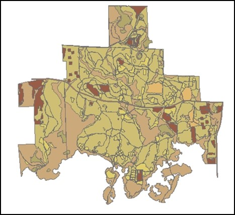
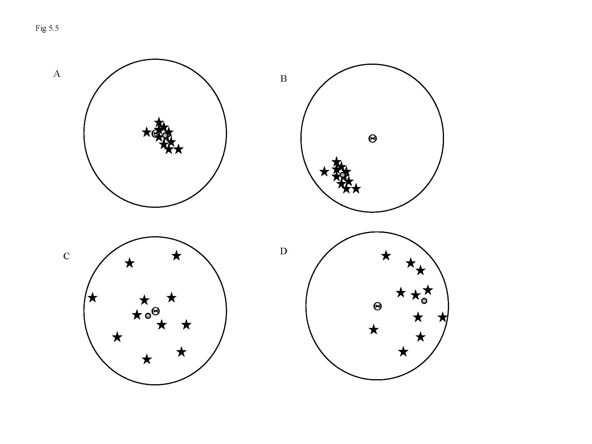
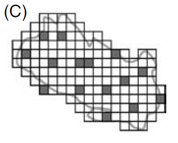
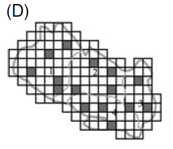
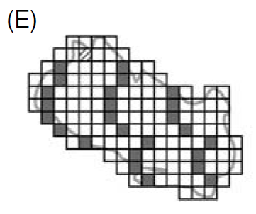

# Introduction {visibility="hidden"}

## {content-align="center" style="font-size: 160%;"}


<center>

**Sampling and Estimation**

<br>

{height="10cm"}
{height="10cm"}

</center>


## Model parameters
  
**Key concepts**

- All models include parameters (e.g., $N$, $r$, $K$, etc\dots).

::: {.fragment}
- Parameters are almost never known. Why?
:::

::: {.fragment}
  * We usually have to sample
  * Animals are hard to detect
:::

::: {.fragment}
- Good sampling designs yield accurate estimates of unknown parameters.
:::
  


## Parameters, estimates, and statistics
  
**Parameter**
A characteristic of a population.
  
::: {.fragment}
**Statistic**
A characteristic of a dataset (often used to estimate a parameter).
:::


  ------------------------ | ---------------------- | -----------------
                         | Population parameter | Parameter estimate
  ------------------------ | ---------------------- | -----------------
  Population size          | $N_t$      | $\hat{N}_t$
  Growth rate              | $r$        | $\hat{r}$
  Occurrence probability   | $\psi$     | $\hat{\psi}$
  ------------------------ | ---------------------- | -----------------


## How do you get accurate estimates?
  

**Properties of a good design:**

::: {style='font-size: 70%;'}
1. Clearly defined objective, in terms of:
    * Parameter(s) that will be estimated
    * Population of interest
    * Criteria for reliability (e.g., precision)
    * Practical constraints (e.g., costs) 
2. Replication
3. Randomization
4. Controls (when conducting an experiment)
  
  
**Bad objective**: "Quantify the abundance of tigers in India"
  
**Better objective**: "Obtain an unbiased estimate of tiger density on the Corbett Tiger Reserve during July 2009, with a coefficient of variation $<$25\% for under \$50,000."
:::


## Defining the population
  
**Target population**
The population of interest. Should be defined in terms of time and space.
  
**Sampled population**
The sampled portion of the population of interest, usually defined in terms of the sample units (such as plots, quadrats, etc.).


## Accuracy has two components

1. **Bias**: The difference between the average estimate and the true parameter
2. **Variance**: The variability of the estimates.
  
  
<center>
{width='60%'}
</center>


## How do we reduce variance?

<br>

::: {.fragment}
::: {.r-fit-text}
  Huge sample size
:::
:::


## Effect of sample size

::: {style='font-size: 80%;'}
Suppose we want to estimate the height of students on campus, and we
have enough resources to repeat a survey many times. <br>
  
Each point below is an estimate. <br>
  

```{r}
#| label: 'N'
#| echo: false
#| eval: true
#| cache: true
#| out-width: '70%'
#| fig-align: 'center'
#| fig-show: 'animate'
height <- 5.5
heightSD <- 0.5
nSim <- 100
x1 <- x2 <- numeric(nSim)
set.seed(343)
for(i in 1:nSim) {
    x1[i] <- mean(rnorm(10, height, heightSD))
    x2[i] <- mean(rnorm(100, height, heightSD))
}
for(i in 1:nSim) {
    par(mfrow=c(1,2), mai=c(0.9, 0.2, 0.4, 0.2))
    plot(0, type="n", frame=FALSE, yaxt="n",
         xlim=c(5, 6), ylim=c(0, 7),
         xlab="Height", ylab="",
         cex.lab=2.5, cex.main=2.5, cex.axis=2,
         main="Sample size of 10")
    abline(v=height, lty=3)
    points(x1[1:i], rep(0, i), cex=2.5, col="blue")
    if(i==nSim)
        hist(x1, freq=FALSE, add=TRUE, border="blue", lwd=2)
    plot(0, type="n", frame=FALSE, yaxt="n",
         xlim=c(5, 6), ylim=c(0, 7),
         xlab="Height", ylab="",
         cex.lab=2.5, cex.main=2.5, cex.axis=2,
         main="Sample size of 100")
    abline(v=height, lty=3)
    points(x2[1:i], rep(0, i), cex=2.5)
    if(i==nSim)
        hist(x2, freq=FALSE, add=TRUE)
    ## dev.off()
}
```

The standard deviation of the sampling distribution is called the standard error (SE)
:::


## How do we reduce bias?
  

::: {.fragment}
::: {.r-fit-text}
Randomization
:::
:::


## Standard sampling designs
  
<br>

**Simple random sampling**
  
::: {style='font-size: 80%;'}
::: {.columns}
::: {.column width='60%'}
- All sample units have the same inclusion probability
- Easiest and most reliable method
- But not always cost effective
:::
::: {.column width='40%'}

:::
:::
:::


## Standard sampling designs
  
<br>

**Stratified random sampling**
  
::: {style='font-size: 80%;'}
::: {.columns}
::: {.column width='60%'}
- Useful when study area is characterized by several homogeneous regions
- Regions with higher variability should be sampled more intensively than regions with low variability
- Often more cost effective than simple random sampling
:::
::: {.column width='40%'}

:::
:::
:::


## Standard sampling designs
  
<br>

**Systematic sampling**
  
::: {style='font-size: 80%;'}
::: {.columns}
::: {.column width='60%'}
- Sample units are selected according to a regular, ordered scheme with the first unit being sampled randomly.
- Easy to implement in the field
- Potentially dangerous because sample unit spacing could coincide with natural spacing of environmental features
:::
::: {.column width='40%'}

:::
:::
:::


## Summary

<br>

We have to estimate model parameters

<br>

Reliable estimates require good sampling design

<br>

Replication reduces variance

<br>

Randomization reduces bias
  


