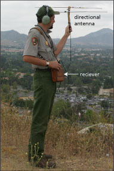
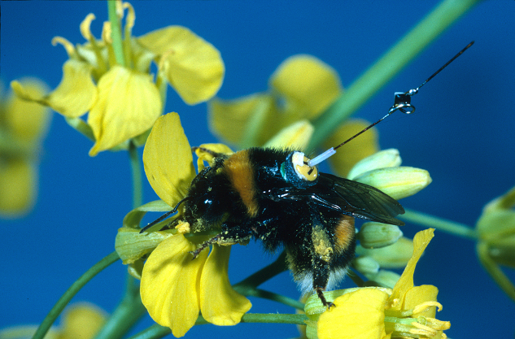

# Introduction {visibility="hidden"}

## {content-align="center" style="font-size: 160%;"}


<center>

**Estimating survival using telemetry**




</center>


## Introduction

Options

- Telemetry
    * Binomial model
    * Kaplan-Meier model
- Age distribution data
    * Often used but rarely valid
- Capture-mark-recapture
    * Covered in the previous lecture
  


# Telemetry


## Telemetry

::: {.columns}
::: {.column width='50%'}

Pros

* Fate is often known
* Analysis can be straight-forward
* Much additional information can be obtained
      
Cons

* Batteries don't last as long as bands
* When fate is unknown, analysis can be hard
* Transmitters may influence vital rates and behavior
      
:::
::: {.column width='50%'}


:::
:::


## Binomial model
  
Design
    
* $n$ animals are randomly sampled and monitored over a fixed time interval
* The fates of all animals are known at end of the study period
* $x$ of the $n$ animals survive
* The estimate of survival over the time interval is given by:
  
$$
    \hat{S} = \frac{x}{n}
$$


## Binomial model
  
Assumptions
    
* Fates are independent
* Fates are known
* All individuals are exposed to mortality during the same time interval
  
When \alert{censoring} occurs, assumptions (2) and (3) are violated.
  
Censoring occurs when the time of mortality is not directly observed


## Censoring

{ %\bf
    Right censoring} 
  
    
    * Occurs when animals leave the sample before they die.
    * Examples
    
      * Battery failure
      * Emigration
    
%    * If right-censored animals are incorrectly thought to be dead,
%      survival estimates will be biased low
  
  
  
  { %\bf
    Left censoring and interval censoring are rarely a concern.}
  % 
  %   
  %   * Occurs when mortality is known to have occurred before some
  %     point in time
  %   * Rarely an issue in telemetry studies
%    * Also known as ``staggered entry''
%    * If left-censored animals are incorrectly thought to enter
%      the study at $t=1$, survival estimates will be biased high
  % 
  
  
  { If censoring occurs, 
    the Kaplan-Meier estimator is more appropriate than the binomial model. <br>}


  ## Censoring
%  [width=0.9\textwidth]{figs/censor}
  
  [width=0.9\textwidth]{figs/censoring} <br>
  Diamonds indicate mortality. Circles indicate censoring. <br>
  Black lines show the observation period. <br> %Gray lines are unobserved
  %time periods. 


  ## Kaplan-Meier
  
  \[
    \hat{S}_t = \prod_{j: t_i \le t}\left(\frac{r_j - d_j}{r_j}\right)
%    \hat{S}(t) = \prod_{j: t_i \le t}\left(\frac{r(j) - d(j)}{r(j)}\right)
  \]
  
  $S_t$ -- probability of surviving to time $t$ <br>
  $r_j$ -- number of individuals ``at risk'' prior to time $t$ <br>
  $d_j$ -- number of mortalities prior to time $t$


  ## Kaplan-Meier in R
```{r}
#| label: kapmeier
#| size: 'footnotesize'
#| eval: false
#| fig.show: 'hide'
library(survival)                    ## Load survival package
deer <- read.csv("deer_data.csv")    ## Import data
S <- Surv(deer$SurvTime, deer$Fate)  ## Format survival data
plot(survfit(S~deer$Sex), lty=1:2,   ## Kaplan-Meier
     main="Survivorship curve",
     xlab="Days since capture (t)",
     ylab="Probability of surviving to time t", cex.lab=1.5)
legend(400, 1, c("Female", "Male"), lty=c(1,2))

```


  ## Kaplan-Meier
  <center>
%    
%    Survivorship curve <br>
%    [width=0.6\textwidth]{figs/survivorship}
    [width=0.70\textwidth]{deerSurv/deerSurvSex} <br>
    \color{blue} 
    \url{
      https://youtu.be/Mgp46izlfeo
    }
  </center>


  ## Kaplan-Meier
  
  {\bf Critical Assumption}: <br>
  Censoring must be independent of survival <br>
 
   * It's fine if transmitters fail randomly
   * It's a problem if they fail because of mortality
 
  
  
%  {\bf }
%  
%    * %  
%  
%  
  {\bf Consequence of violating this assumption}: <br>
  If an animal dies, but you mistakenly right censor it because you
  think its battery died, survival will be over-estimated.  


# Age distributions


  ## Age distribution data
  {%\bf
    Standard practice}
  
    * We have a pile of wings that can be aged <br>
    * We assume the age ratios tell us something about survival
  
  <center>
    [width=0.6\textwidth]{figs/dove_wing}
  </center>
  
%  Before considering this, let's image a better situation\dots
  { \alert{\bf There are many problems with this} \par}


  ## Alternative scenario
%  
  Suppose a cohort of individuals is monitored over time, so that we
  can obtain information about survival.
  
\[
  n_{i+1,t+1} = n_{i,t}S_{i,t}
\]

\[
  S_{i,t} = \frac{n_{i+1,t+1}}{n_{i,t}}
\]
% 


 %\bf
  All is well. This is a valid approach based on the
  binomial model. <br>


  ## Age distributions
  
  The problem is that this\dots
  
\[
  S_{i,t} = \frac{n_{i+1,t+1}}{n_{i,t}}
\]
  
  
  \dots is not the same as data from ``standing age distribution''
  
\[
  S_{i,t} = \frac{n_{i+1,t}}{n_{i,t}}
\]
  
  
  
  Several pitfalls are associated with this problem.


  ## Pitfall I
  
  Standing age distribution data can't be used to estimate
    survival, unless\dots <br>
  
    * Population is at the stable age distribution
    * $\lambda = 1$
  


  ## Pitfall II
  
  {\bf Population reconstruction} refers to the calculation of the abundance
  and age distribution of a cohort at some initial time, usually based
  on ``ages at death''. <br>
  
  
  This is only possible if we know the ages of death for \alert{\bf all}
  individuals in the cohort. <br>
  
  
  Shouldn't use this type of ``reconstruction data'' as real data in a
  subsequent analysis.


## Pitfall III

The age data are biased
  
* Age data not representative of actual age distribution
* Hunting, trapping, and capture-recapture methods do not evenly sample the population
  


## Avoiding the pitfalls
  
When estimating survival, it is always good to...
  
* Collect more than 1 year of data
* Follow multiple cohorts of individuals over long periods of time
* Estimate survival using telemetry or mark-recapture methods
  


