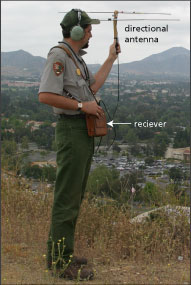
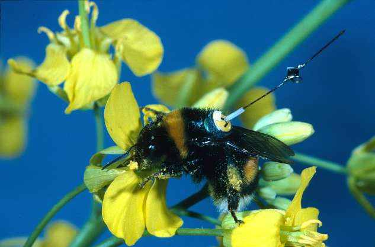
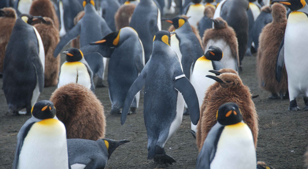
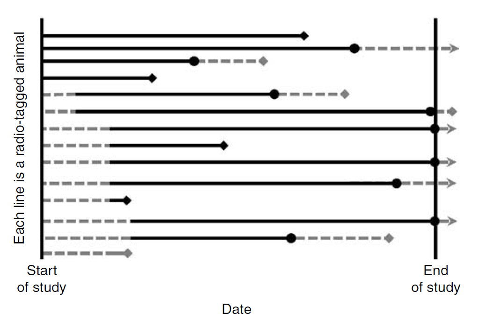
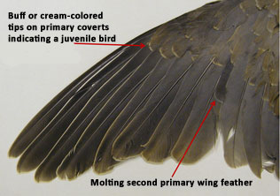

# Introduction {visibility="hidden"}

## {content-align="center" style="font-size: 160%;"}


<center>

**Estimating survival using telemetry**

{height="10cm"}
{height="10cm"}

::: {style='font-size: 60%;'}
Applied Population Dynamics

WILD 5700/7700
:::

</center>


## Introduction

Options for estimating survival:

- Telemetry
    * Binomial model
    * Kaplan-Meier model

::: {.fragment}
- Age distribution data
    * Often used but rarely valid
:::

::: {.fragment}
- Capture-mark-recapture
    * Covered in the previous lecture
:::
  


# Telemetry


## Telemetry

::: {.columns}
::: {.column width='60%'}

::: {style='font-size: 80%;'}
Pros

* Fate is often known
* Analysis can be straight-forward
* Much additional information can be obtained
      
::: {.fragment}
Cons

* Batteries don't last as long as bands
* When fate is unknown, analysis can be hard
* Transmitters may influence vital rates and behavior
:::
 
:::
     
:::
::: {.column width='40%'}

{width="100%"}

{width="100%"}

:::
:::


## Binomial model

::: {style='font-size: 80%;'}

<br>

Design

* $n$ animals are randomly sampled and monitored over a fixed time interval.

::: {.fragment}
* The fates of all animals are known at end of the study period.
:::

::: {.fragment}
* $x$ of the $n$ animals survive.
:::

::: {.fragment}
* The estimate of survival over the time interval is given by:

$$
    \hat{S} = \frac{x}{n}
$$
:::

:::


## Binomial model
  
::: {style='font-size: 100%;'}
Assumptions
    
1. Fates are independent
2. Fates are known
3. All individuals are exposed to mortality during the same time interval
  
::: {.fragment}
When [censoring]{.key-term} occurs, assumptions (2) and (3) are violated.
:::
  
::: {.fragment}
Censoring occurs when the time of mortality is not directly observed.
:::

:::


## Censoring

Right censoring
  
- Occurs when animals leave the sample before they die.
- Examples:
    * Battery failure
    * Emigration
    
::: {.fragment}
Left censoring and interval censoring are rarely a concern.
:::
  
::: {.fragment}
If censoring occurs, the Kaplan-Meier estimator is more appropriate than the binomial model.
:::


## Censoring

<center>
::: {.framed-img}
{height="11cm"}
:::

::: {style='font-size: 80%;'}
Diamonds indicate mortality. Circles indicate censoring. <br>
Black lines show the observation period. 
:::

</center>


## Kaplan-Meier

<br>

$$
    \hat{S}_t = \prod_{j: t_i \le t}\left(\frac{r_j - d_j}{r_j}\right)
$$

$S_t$ -- probability of surviving to time $t$ <br>
$r_j$ -- number of individuals *at risk* prior to time $t$ <br>
$d_j$ -- number of mortalities prior to time $t$


## Kaplan-Meier in R

```{r}
#| label: kapmeier
#| cache: true
library(survival)                    ## Load survival package
deer <- read.csv("deerSurv/deer_data.csv")    ## Import data
S <- Surv(deer$SurvTime, deer$Fate)  ## Format survival data
plot(survfit(S~deer$Sex), lty=1:2,   ## Kaplan-Meier
     main="Survivorship curve",
     xlab="Days since capture (t)",
     ylab="Probability of surviving to time t", cex.lab=1.5)
legend(400, 1, c("Female", "Male"), lty=c(1,2))

```


<center>

[Deer capture video](https://youtu.be/Mgp46izlfeo)

</center>


## Kaplan-Meier
  
::: {style='font-size: 80%;'}

<br>

**Critical Assumption**: Censoring must be independent of survival
 
* It's fine if transmitters fail randomly
* It's a problem if they fail because of mortality
 
<br>
  
::: {.fragment}
*Consequence of violating this assumption*:

If an animal dies, but you mistakenly right censor it because you think its battery died, survival will be over-estimated.
:::


:::


# Age distributions


## Age distribution data

Standard practice
  
* We have a pile of wings that can be aged
* We assume the age ratios tell us something about survival
  
<center>
{height="7cm"}
  
::: {.fragment}
[**There are many problems with this approach.**]{.callout--caution}
:::

</center>


## Alternative scenario

Suppose a cohort of individuals is monitored over time, so that we can obtain information about survival.
  
$$
  n_{i+1,t+1} = n_{i,t}S_{i,t}
$$

::: {.fragment}
$$
  S_{i,t} = \frac{n_{i+1,t+1}}{n_{i,t}}
$$
:::

<br>


<center>
::: {.fragment}
All is well. This is a valid approach based on the binomial model.
:::
</center>


## Age distributions
  
The problem is that this...
  
$$
  S_{i,t} = \frac{n_{i+1,t+1}}{n_{i,t}}
$$
  
  
... is not the same as data from *standing age distribution*:
  
$$
  S_{i,t} = \frac{n_{i+1,t}}{n_{i,t}}
$$
  
  
  
<center>
::: {.fragment}

[**Several pitfalls are associated with this problem**.]{.callout--caution}

:::
</center>


## Pitfall I


<br>

Standing age distribution data can't be used to estimate survival, unless...
  
* Population is at the stable age distribution
* $\lambda = 1$
  


## Pitfall II
  
<br>

**Population reconstruction** refers to the calculation of the abundance and age distribution of a cohort at some initial time, usually based on *ages at death*.

<br>

::: {.fragment}
This is only possible if we know the ages of death for **all** individuals in the cohort.
:::

<br>

::: {.fragment}
Shouldn't use this type of *reconstruction data* as real data in a subsequent analysis.
:::


## Pitfall III

<br>

The age data are biased
  
* Age data not representative of actual age distribution.
* Hunting, trapping, and capture-recapture methods do not evenly sample the population.
  


## Avoiding the pitfalls

<br>

When estimating survival, it is always good to...
  
* Collect more than 1 year of data.
* Follow multiple cohorts of individuals over long periods of time.
* Estimate survival using telemetry or mark-recapture methods.
  


